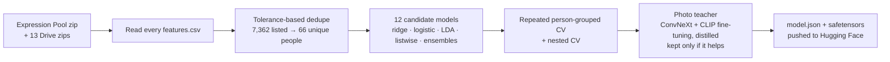

<div align="center">

# 🎭 Face Expression Matcher

**Ten photos of one person in. One of ten expressions per photo out. A grader-ready submission JSON in one click.**

A one-shot solver for the IITM BS **Tools in Data Science, Project 1, Question 8** (face-expression bonus).

[](https://face-expression-app-tds-p1-q8-t3-2026.streamlit.app/)

[](https://huggingface.co/23f1000805/face-expression-v3)


[](https://github.com/GyaanFlow/face-expression-app/actions)

**[Live app](https://face-expression-app-tds-p1-q8-t3-2026.streamlit.app/)** · **[Model card](https://huggingface.co/23f1000805/face-expression-v3)** · **[Training notebook](Notebook/face_expression_v4_pooled.ipynb)** · **[How it works](#-how-it-works)** · **[Results](#-results)** · **[Run locally](#-run-locally)**

</div>

---

## ✨ Highlights

| | |
|---|---|
| 📦 **Submission JSON in one click** | Downloads `model.json` in the exact `linear-rank-v1` format the assignment page accepts, with every rule checked before you download it. |
| 🧪 **Try it in 30 seconds** | A built-in example person (`person_a`) runs instantly with true labels, so new visitors see a full result straight away. |
| 🖼️ **Test with your own photos** | Upload ten photos of one person; Py-Feat reads each face and the model assigns each expression exactly once. |
| 📄 **Test with a features csv** | Paste the assignment's `features.csv` (one or many people) for instant results, with match / mismatch against the labels. |
| 🛠️ **Train your own** | Upload your `features.csv` files and the app trains a model on them, removes duplicate people and estimates its accuracy. |
| ✅ **JSON checker** | Validate any submission file: keys, version, 10 × 156 shape, finite numbers, size under 64 KiB, and strict JSON. |
| 📊 **Model insights** | Accuracy per expression, learning curve, confusion matrix and model leaderboard, read live from the Hub. |
| 🔄 **Always the latest model** | The app loads weights from Hugging Face and refreshes every 6 hours, or immediately with **Reload latest model**. |

---

## 🚀 Quick start (for students)

1. Open the **[live app](https://face-expression-app-tds-p1-q8-t3-2026.streamlit.app/)**. The first load can take a minute while the free server wakes up.
2. Go to the **Get submission JSON** tab and press **Download model.json**.
3. On the assignment page: **Choose File** → select `model.json` → **Check** → **Save**.

> [!NOTE]
> A valid JSON earns 0 marks at submission time. The bonus is graded later on **unseen people**: 0 marks at 60% accuracy, 5 at 70%, 10 at 80% or above. This model scores about **70% on people it has never seen**, so treat it as a strong starting point, not a guarantee.

---

## 🧠 How it works


- **Features.** Py-Feat turns each photo into 78 numbers: facial movements (blendshapes), muscle activations (action units) and emotion scores.
- **Within-person ranks.** Each number is also ranked among the person's ten photos (scaled 0 to 1), so the model compares a photo with that person's other photos, not with strangers.
- **Linear scores.** `scores = weights × inputs` gives every photo a score for every expression. This is exactly what the grader computes, so the downloaded JSON behaves the same way.
- **One-to-one matching.** The Hungarian algorithm picks the assignment with the highest total score, using each expression once.

### Training pipeline



Every number below comes from people the model never saw during training. All ten photos of a person always stay on the same side of a split, and duplicate people across zips are removed first, because they inflate scores (in one test a missed duplicate check turned 0.71 into a misleading 0.80).

---

## 📈 Results

| Metric | Value |
|---|---|
| Unique people (after removing duplicates) | **66** (660 photos) |
| **Nested CV accuracy on unseen people** | **69.9%** |
| Best single candidate (ridge + logistic ensemble) | 71.2% |
| 95% bootstrap interval over people | 68.3% – 78.2% |
| Accuracy on the training people (not a real score) | 83.3% |
| Fine-tuned photo teacher (ConvNeXt + CLIP) | 56.4%, not used (gain +0.3 points) |
| Chance level | 10% |

**Learning curve** (held-out people):

| Training people | 13 | 26 | 39 | 53 |
|---|---|---|---|---|
| Accuracy | 62.1% | 63.8% | 66.4% | 67.5% |

The curve is still rising, so more **genuinely new** people are the main way to improve. Bigger models did not help: the linear grader format and the near-identical pairs **sad vs hopelessness** and **scepticism vs uncertainty** set the ceiling, which is why 100% is not reachable here.

---

## 🖥️ Run locally

```bash
git clone https://github.com/GyaanFlow/face-expression-app.git
cd face-expression-app
pip install -r requirements.txt
streamlit run streamlit_app.py
```

Without Py-Feat and torch, everything except brand-new photo uploads still works (the demo, the csv tab, the JSON tab and model insights).

### Configuration

Set these as Streamlit secrets (`.streamlit/secrets.toml`) or environment variables:

| Name | Default | Purpose |
|---|---|---|
| `MODEL_REPO` | `23f1000805/face-expression-v3` | Hugging Face repo with `config.json` and `model.safetensors` |
| `HF_TOKEN` | – | Only needed if the model repo is private |

### Deploy on Streamlit Community Cloud (free)

1. Push this repo to GitHub.
2. On [share.streamlit.io](https://share.streamlit.io) choose **Create app**, pick the repo and set the main file to `streamlit_app.py`.
3. Under **Advanced settings**, choose Python 3.11 and add `HF_TOKEN` if the model repo is private.

Full notes are in [DEPLOY.md](DEPLOY.md).

### Tests

```bash
pip install pytest numpy pandas scipy scikit-learn pillow safetensors huggingface_hub
pytest -q
```

22 tests cover the grader-format validator (including NaN, Infinity, duplicate keys and size limits), training and duplicate removal, one-to-one matching, and HTML escaping. They run on every push through GitHub Actions.

---

## 🗂️ Project structure

```
face-expression-app/
├── streamlit_app.py      # the app: tabs, demo, photo and csv flows, insights
├── matcher.py            # loads weights from the Hub, computes scores, Hungarian matching
├── extractor.py          # Py-Feat wrapper (photo → 78 features), read-only-install safe
├── submission.py         # builds and strictly validates the linear-rank-v1 JSON; route B training
├── ui.py                 # cards, heatmap, tiles, footer (all user text escaped)
├── Notebook/
│   └── face_expression_v4_pooled.ipynb   # training: pooled data, dedupe, nested CV, push to the Hub
├── examples/
│   ├── person_a/         # ten example photos
│   └── person_a.csv      # their saved features + photo fingerprints (instant demo)
├── tests/                # pytest suite
├── .streamlit/config.toml
├── requirements.txt · packages.txt
├── DEPLOY.md
└── .github/workflows/tests.yml
```

---

## 🔄 Retraining and updating the live app

1. Run the training notebook [`Notebook/face_expression_v4_pooled.ipynb`](Notebook/face_expression_v4_pooled.ipynb) in Colab. It collects the data, removes duplicates, picks the model by honest CV and pushes to `23f1000805/face-expression-v3`.
2. In the app, press **Reload latest model** (or wait up to 6 hours).

Keep the same repo name and the same 78 feature columns; the app rejects a model whose shape does not match.

---

## 🔒 Privacy and responsible use

- Uploaded photos are processed in memory and in a temporary file that is deleted after each run. Nothing is stored or logged.
- Predictions describe the **expression a person was asked to show**, not how anyone actually feels.
- Only upload photos of people who agreed to it. The course asks students not to share classmates' photos on outside services.

---

## 🙏 Acknowledgements

- [Py-Feat](https://py-feat.org) for facial feature extraction (Detectorv2).
- [Hugging Face Hub](https://huggingface.co) for model hosting, [Streamlit](https://streamlit.io) for the app, [scikit-learn](https://scikit-learn.org) and [timm](https://github.com/huggingface/pytorch-image-models) for modelling.
- Classmates who shared their `features.csv` files through the Expression Pool.

---

<div align="center">

### Built by **Gaurav Tomar**

Student, IIT Madras BS in Data Science and Applications

[](https://www.linkedin.com/in/gaurav-tomar-630b2a316)
[](https://github.com/GyaanFlow)
[](https://huggingface.co/23f1000805)
[](https://tds-portal-solver.vercel.app)

Design, data pipeline, model training, app and deployment by Gaurav Tomar.

If this helped you, please ⭐ the repo and share it with your batch. Found a bug or have an idea? [Open an issue](https://github.com/GyaanFlow/face-expression-app/issues).

<sub>© 2026 Gaurav Tomar. Made for the IITM BS Tools in Data Science course; not an official course tool.</sub>

</div>
